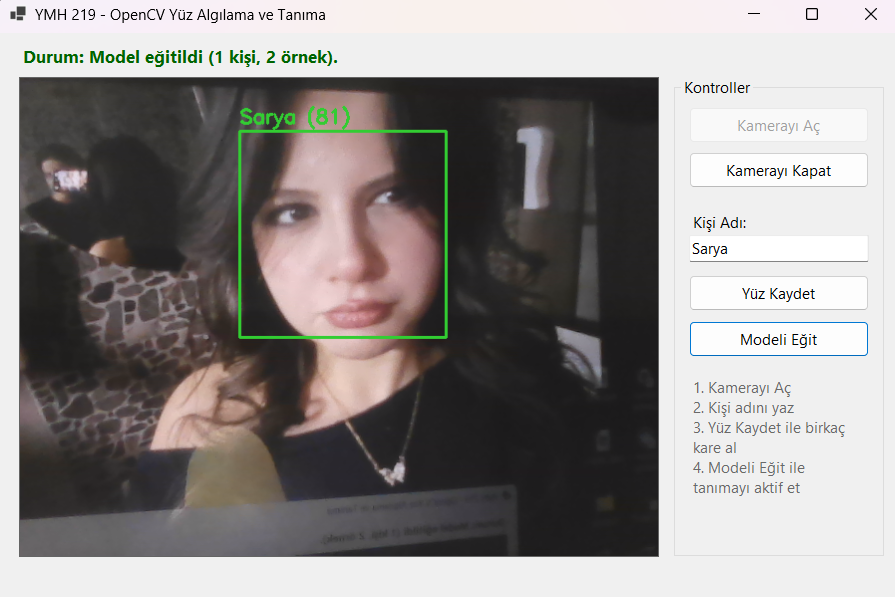
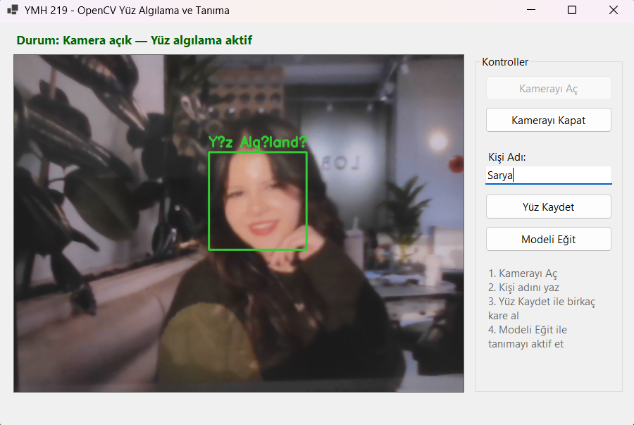

# YMH219 - Yüz Algılama ve Tanıma Uygulaması

C# ve `OpenCvSharp4` kullanılarak geliştirilmiş, kamera üzerinden gerçek zamanlı yüz algılama, kişi bazlı yüz örneği kaydetme ve `LBPHFaceRecognizer` ile yüz tanıma/durum yönetimi sunan Windows Forms masaüstü uygulaması. Nesne Tabanlı Programlama (YMH 219) uygulama ödevi kapsamında hazırlanmıştır.

## Kullanılan Teknolojiler
- C#
- .NET (`net11.0-windows`, Windows Forms)
- `OpenCvSharp4`, `OpenCvSharp4.runtime.win`, `OpenCvSharp4.Extensions`
- `haarcascade_frontalface_default.xml` (Haar Cascade yüz algılama modeli)
- Visual Studio

## Kurulum ve Çalıştırma
1. Repoyu klonla: `git clone https://github.com/saryaasu/YMH219-FaceRecognition.git`
2. `cascades/haarcascade_frontalface_default.xml` dosyasının `cascades` klasöründe bulunduğundan emin ol ve NuGet paketlerini geri yükle (`dotnet restore`)
3. Proje dosyasını (`.csproj` veya `.slnx`) Visual Studio ile aç ve **F5** ile derleyip çalıştır (veya `dotnet run --project YMH219-FaceRecognition.csproj`)

## Uygulama Kontrolleri ve Özellikleri
- **Kamera ve Yüz Algılama:** **Kamerayı Aç** ve **Kamerayı Kapat** işlevleri; `CascadeClassifier` ile canlı karelerde yüz tespiti ve çerçeve/etiket çizimi
- **Yüz Veri Seti Kaydı:** Girilen kişi adına göre `dataset/` klasörü altında 200x200 boyutunda gri tonlamalı yüz görüntülerinin (**Yüz Kaydet**) kaydedilmesi
- **Model Eğitimi ve Tanıma:** **Modeli Eğit** ile `LBPHFaceRecognizer` modelinin eğitilmesi, `trainer.yml` dosyasına kaydedilmesi ve canlı görüntüde kişi adı ile güven skorunun gösterilmesi
- **Durum Göstergesi ve Kaynak Yönetimi:** Kamera, kayıt ve eğitim durumunun üst durum etiketinde (`lblDurum`) bildirilmesi; form kapanırken kamera, zamanlayıcı ve OpenCV nesnelerinin güvenli biçimde serbest bırakılması

## Ekran Görüntüleri

### Uygulama Penceresi

### GitHub Deposu

## Bilinen Sınırlamalar / Geliştirme Notları
- `cascades/haarcascade_frontalface_default.xml` dosyası veya aktif kamera/izin bulunmadığında kullanıcı bilgilendirme/uyarı mesajı alır
- Kayıtlı kişi/örnek silme veya tanıma güven eşiği (`confidence`) değerini arayüzden ayarlama özelliği henüz eklenmedi

## Öğrenci
Sarya Su Toğyıldız - 250542024